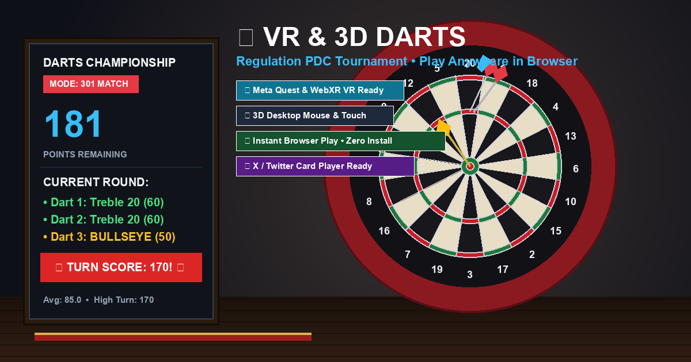

# 🎯 VR & 3D Darts Championship

A tournament-regulation darts game built in **Three.js** and **WebXR**, designed for both **Meta Quest / Oculus VR headsets** and **everyday browser users on desktop, tablet, and mobile**. Embeddable as an interactive **Twitter / X Player Card**.



---

## 🌟 Live Links

- **Hosted Web App:** [https://xyzzyapps.github.io/darts/](https://xyzzyapps.github.io/darts/)
- **Local Dev Server:** [https://localhost:3000/](https://localhost:3000/)
- **Oculus / Quest Local Wi-Fi:** `https://<YOUR-IP>:3000/`

---

## 🥽 Meta Quest & Oculus VR Mode

1. Open the URL in the **Meta Quest Browser** (or Wolvic / PCVR browser).
2. Click the **ENTER VR** button.
3. You will stand at the regulation **Oche (2.37m / 7 ft 9¼ in)** facing the dartboard at eye level (bullseye at 1.73m).
4. **Grab Dart:** Squeeze **Trigger** or **Grip** on your Touch controller.
5. **Throw:**
   - **Physical Throw:** Bring your arm back, swing forward, and release Trigger/Grip at the release point (uses real-time controller velocity tracking).
   - **Button Throw (Relaxed / Small Rooms):** Point your controller ray at the target and press the **`A`** button (or **`X`** on left controller).
   - **Next Turn:** Press the **`B`** button (or point laser at the 3D scoreboard button and pull trigger).
6. **Haptic Rumble:** Controller vibration on grab, release, and board impact.

---

## 📱 Mobile & Normal 3D Mode (No VR Headset Needed)

- **Tap / Click to Throw:** Tap or click anywhere on the dartboard to throw directly at that coordinate.
- **Drag & Flick:** Click and drag upward towards the board; release with speed to throw with momentum.
- **Precision Power Meter:** Hold **`[Space]`** or Left-Click to charge the power bar, and release when in the **green sweet spot (~75%)**.
- **On-Screen Throw Button:** A prominent `🎯 THROW DART` button is available for one-touch mobile throws.
- **In-Hand 3D Dart Viewmodel:** Realistic 3D held dart with breathing sway and aim pullback.
- **Dynamic Trajectory Guide (`[T]`):** Parabolic flight path preview taking gravity into account.
- **Interactive 3D Scoreboard:** Click directly on the wall chalkboard buttons (`NEXT TURN`, `RESET`, `MODE`) with your mouse or finger.
- **Camera Views:**
  - `[1]` **Oche (2.37m):** Regulation toe line view.
  - `[2]` **Board Zoom:** Close-up inspection of dart groupings.
  - `[3]` **Scoreboard Cam:** Direct chalkboard view.
  - `[4]` **Free 3D Cam:** Free look around the pub.

---

## 🐦 Twitter / X Player Card Ready

Configured for inline interactive execution directly inside the X/Twitter timeline via Twitter Player Card meta tags:
- **Card Type:** `player` (640x360)
- **Hosted Target:** `https://xyzzyapps.github.io/darts/`
- **Iframe Friendly:** Full-viewport fluid layout (`viewport-fit=cover`), touch-action optimizations, overscroll prevention, and auto-resuming Web Audio API on first touch.

---

## 🏆 Game Modes & Official Rules

1. **301 Countdown (Default):** Classic pub countdown with **Bust rules** (score resets to start of round if you go below zero or leave 1).
2. **501 Tournament:** Full PDC world championship format.
3. **Around the Clock:** Hit sectors 1 through 20 in order, finishing on the Bullseye!
4. **Free Play:** Casual throw practice with 3-dart averages, high turn records, and 180 callouts!

---

## 📐 PDC Regulation Dimensions

- **Bullseye Center Height:** 1.73m (5 ft 8 in) from the floor.
- **Throwing Distance (Oche):** 2.37m (7 ft 9¼ in) with raised toe-board.
- **Double Bull (Bullseye):** 12.7mm diameter (50 pts, red).
- **Single Bull (Outer Bull):** 31.8mm diameter (25 pts, green).
- **Treble Ring:** 97mm - 107mm radius (3x sector points).
- **Double Ring:** 162mm - 170mm radius (2x sector points).
- **Surround Ring:** Velvet/foam ring catching misses.

---

## 🚀 Development & Build

```bash
# Install dependencies
npm install

# Start local HTTPS dev server (with LAN access for Meta Quest)
npm run dev

# Build for production
npm run build

# Preview production build
npm run preview
```

---

## 📄 License

Copyright (c) 2026 Xyzzy Apps <xyzzyapps@gmail.com>. All rights reserved.
